# claude-voice

[](https://github.com/MatteoSid/Claude-SSH-Voice-Tunnel/actions/workflows/ci.yml)
[](https://pypi.org/project/claude-ssh-voice/)
[](LICENSE)

<p align="center">
  
</p>

Use Claude Code's native **`/voice`** dictation when Claude Code runs on a remote server over SSH
(plain SSH or VS Code Remote-SSH terminals).

Claude Code records audio on the machine where `claude` runs. Over SSH that machine has no microphone, so `/voice`
fails with `could not open an audio capture device`. `claude-voice` streams the microphone of **your computer** to the
server through the SSH connection:

```
your mic -> claude-voice daemon -> ssh -R tunnel -> server: fake `arecord`/`rec` -> claude /voice
```

No WSL, PulseAudio, sox or root access needed. Nothing listens on the network: everything goes through SSH.

## Requirements

| Your computer (client)                                    | Server                                                   |
|-----------------------------------------------------------|----------------------------------------------------------|
| Windows, macOS or Linux                                   | Linux with `bash`, `ss`, `tar` (standard on most distros) |
| Python 3.9+ and [uv](https://docs.astral.sh/uv/) or pipx  | [Claude Code](https://docs.claude.com/en/docs/claude-code) logged in with a Claude.ai account |
| OpenSSH client with **key-based** login to the server     | Shell: bash, zsh or fish                                 |
| Linux only: `sudo apt install libportaudio2`              |                                                          |

## Install (on your computer)

```sh
uv tool install claude-ssh-voice
# or: pipx install claude-ssh-voice
# or the latest development version:
uv tool install git+https://github.com/MatteoSid/Claude-SSH-Voice-Tunnel
```

This gives you the `claude-voice` command.

## Quick start

`HOST` is anything `ssh` accepts: `user@server`, or better an alias from `~/.ssh/config`.

```sh
claude-voice test                   # 1. records 3 s into mic-test.wav and checks it isn't silent
claude-voice install-remote HOST    # 2. installs the server side (once per server)
claude-voice autostart HOST         # 3. keeps the mic tunnel running, now and at every login
```

Then, in a **new** terminal on the server (VS Code included): run `claude`, type `/voice`, and hold space to talk.
Set the dictation language with `/config` inside Claude Code.

That's it. To check it's working: on the server `ss -ltn | grep 48713` should show a listening socket.

## Commands

| Command                              | What it does                                                                                 |
|--------------------------------------|----------------------------------------------------------------------------------------------|
| `claude-voice devices`               | List microphones (use the index or name with `--device`)                                     |
| `claude-voice test`                  | Record a short clip to check the mic (`--seconds`, `--out`, `--device`)                      |
| `claude-voice install-remote HOST`   | Copy the helper scripts to `~/.claude-voice` on the server and hook `claude` in your shell rc |
| `claude-voice uninstall-remote HOST` | Remove everything `install-remote` added                                                      |
| `claude-voice autostart HOST`        | Run the daemon at login: Startup folder (Windows), LaunchAgent (macOS), systemd user unit (Linux). `--remove` to undo |
| `claude-voice daemon HOST`           | Run the tunnel in the foreground; reconnects automatically. Log: `~/.claude-voice/daemon.log` |
| `claude-voice connect HOST`          | One-off interactive SSH session with the tunnel, instead of the daemon                       |

Options for `daemon`, `autostart`, `connect`: `--port` (remote port, default `48713`), `--device`.
Extra `ssh` options go after `--`, e.g. `claude-voice autostart myserver -- -p 2222 -i ~/.ssh/id_work`.
You can autostart one daemon per server.

If you change `--port`, also set `export CLAUDE_VOICE_PORT=<port>` in your shell rc on the server.

## How it works

- **Client**: a small Python bridge opens the microphone only while the server is reading from it, and streams
  16 kHz mono PCM to `127.0.0.1`. The daemon runs `ssh -N -R 48713:127.0.0.1:<bridge>` so the stream appears on
  the server at `127.0.0.1:48713`.
- **Server**: `install-remote` puts a fake `arecord`/`rec` in `~/.claude-voice/shim` that just reads that socket,
  and defines `claude` as a shell function calling `~/.claude-voice/bin/claude-wrap`. When the tunnel is up, the
  wrapper puts the shim first in `PATH` for that `claude` process only; when it's down, it runs plain `claude`.
  `CLAUDE_VOICE_OFF=1 claude` forces plain mode.

### Why the wrapper hides `/proc/asound/cards`
Claude Code uses native ALSA capture whenever `/proc/asound/cards` lists any sound card, even a playback-only one
(e.g. GPU HDMI), and then never calls `arecord` (symptom: `ALSA lib ... cannot find card '0'`). In that case the
wrapper starts `claude` in an unprivileged user+mount namespace (same uid) where that file is empty.
Side effect: no `sudo` inside that `claude` session. If unprivileged user namespaces are disabled, it runs without.

## Troubleshooting

| Symptom                                               | Fix |
|-------------------------------------------------------|-----|
| `could not open an audio capture device`              | The tunnel isn't up. Check `~/.claude-voice/daemon.log` on your computer, and `ss -ltn \| grep 48713` on the server. Open a **new** server terminal after `install-remote`. |
| Daemon log shows `Permission denied (publickey)`      | The daemon can't type a password: set up an SSH key (`ssh-copy-id HOST`) and make sure `ssh HOST` works without prompts. |
| `remote port forwarding failed for listen port 48713` | Another daemon (maybe another computer) already holds the port. Stop it, or use a different `--port`. |
| Transcription is empty                                | Run `claude-voice test` and check the level; pick the right mic with `--device`. macOS: allow your terminal (or Python) to use the microphone in System Settings › Privacy. |
| `PortAudio library not found` (Linux client)          | `sudo apt install libportaudio2` |
| `ALSA lib ... cannot find card '0'`                   | Unprivileged user namespaces are disabled on the server (see above). |

## Security

The bridge listens on `127.0.0.1` only and opens the microphone only while a recorder is connected. While the tunnel
is up, **any process on the server** that connects to the forwarded port can hear your microphone (including other
users on multi-user machines). Only use this with servers you trust.

## Limitations

- Server must be Linux. The VS Code **Claude Code extension** (its own bundled binary) is not supported; the
  `claude` CLI in a VS Code terminal is.
- A WSL2 server reached through Windows OpenSSH works with `networkingMode=mirrored` in `.wslconfig` (the tunnel
  listens on the Windows side and WSL reaches it over the shared loopback). Other networking modes are untested.
  `install-remote` doesn't support it yet: it runs its script in the Windows shell, not in WSL.
- Tested: Windows 11 client, Ubuntu 22.04 server, bash, VS Code Remote-SSH terminal. Also an Ubuntu 26.04 client
  (systemd autostart) with an Ubuntu 22.04 server and with a WSL2 (mirrored) server, over plain SSH. macOS
  autostart and zsh/fish hooks are newer and less tested: reports welcome.

## Contributing

Issues and pull requests are welcome, see [CONTRIBUTING.md](CONTRIBUTING.md).

## License

[MIT](LICENSE). Not affiliated with Anthropic.
